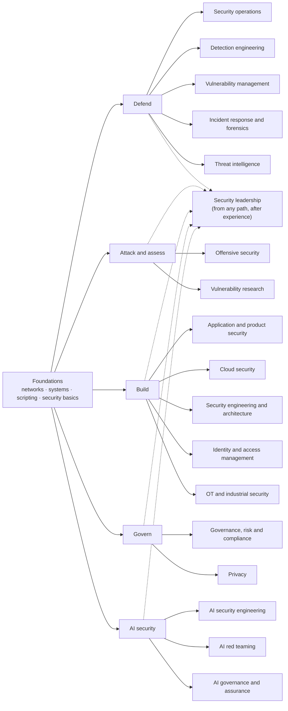

# Security Career Paths

**A map of careers in information security, cybersecurity and AI security: what each path involves, how people get in, how they progress, and where to learn, mostly for free.**

**Web edition:** [Browse the searchable site](https://thenayanhazra.github.io/security-career-paths/) · [Interactive Path Finder](https://thenayanhazra.github.io/security-career-paths/finder.html) · [Certifications Explorer](https://thenayanhazra.github.io/security-career-paths/certifications.html) · [Career Transition Map](https://thenayanhazra.github.io/security-career-paths/map.html) · [JSON data](https://thenayanhazra.github.io/security-career-paths/data/paths.json)

Security is not one job. A detection engineer, a penetration tester, a privacy auditor and an AI red-teamer share a field and little else. This guide lays out the main paths side by side so you can choose deliberately, then gives each one a route from first steps to senior work.

It is written for two readers: people trying to get in, and people already in who want to move sideways or up.

## Start here

| If you are... | Read |
|---|---|
| New to the field, or still deciding | [How to choose a path](guides/choosing-a-path.md), then [Foundations](guides/foundations.md) |
| Ready to apply for your first role | [Getting your first role](guides/first-role.md) and [Interviews and portfolios](guides/interviews-and-portfolios.md) |
| Comparing employer types or regional markets | [Where security teams sit](guides/employers-and-markets.md) |
| Already working in security and want to change direction | The path you are considering, then [Moving between paths](guides/moving-between-paths.md) |
| Moving from mid-level to Staff+, principal or leadership | [Advancing past mid-level](guides/senior-progression.md) |
| Weighing up certifications | [Certifications by path and level](guides/certifications.md) |
| Looking for hands-on practice | [Practice labs and platforms](guides/practice.md) |
| Using AI tools to learn or work in security | [Working with AI in security](guides/working-with-ai.md) |
| Wanting to keep up once you are in | [Staying current](guides/staying-current.md) |
| Unfamiliar with an acronym or term | [Glossary](guides/glossary.md) |

## The paths

The AI security paths draw on the others: AI security engineering builds on application and cloud security, AI red teaming on offensive security, and AI governance on GRC and privacy.

| Family | Path | In one line | Typical entry |
|---|---|---|---|
| Defend | [Security operations](paths/security-operations.md) | Watch, detect and respond to threats as they happen | Beginner-friendly |
| Defend | [Detection engineering](paths/detection-engineering.md) | Build, test and maintain detections and telemetry as code | Usually from SOC or software/data engineering |
| Defend | [Vulnerability management](paths/vulnerability-management.md) | Find known weaknesses at scale, prioritise them and get them fixed | Beginner-friendly via IT operations |
| Defend | [Incident response and digital forensics](paths/incident-response-forensics.md) | Work out what happened, contain it and recover | Usually after 1–3 years in operations or IT |
| Defend | [Threat intelligence](paths/threat-intelligence.md) | Understand adversaries and turn that into decisions | Varies; analysts from many backgrounds |
| Attack and assess | [Offensive security](paths/offensive-security.md) | Test systems the way attackers would, with permission | Possible to enter directly; most come from IT or development |
| Attack and assess | [Vulnerability research](paths/vulnerability-research.md) | Find new classes of flaw in software and hardware | Usually after deep programming experience |
| Build | [Application and product security](paths/application-security.md) | Help engineers build software that is secure by design | Often from software development |
| Build | [Cloud security](paths/cloud-security.md) | Secure workloads and platforms on AWS, Azure and GCP | Often from cloud engineering or operations |
| Build | [Security engineering and architecture](paths/security-engineering-architecture.md) | Design and run the controls everything else depends on | Mid-career |
| Build | [Identity and access management](paths/identity-access-management.md) | Decide who and what can access what, and prove it | Beginner-friendly via IT administration |
| Build | [OT and industrial security](paths/ot-industrial-security.md) | Protect systems that move physical things | Often from engineering or operations |
| Govern | [Governance, risk and compliance](paths/governance-risk-compliance.md) | Turn standards and risk into decisions and evidence | Beginner-friendly; strong route for career changers |
| Govern | [Privacy](paths/privacy.md) | Make sure personal data is handled lawfully and fairly | Often from legal, compliance or GRC |
| AI security | [AI security engineering](paths/ai-security-engineering.md) | Secure systems built on models and agents | Usually from application, cloud or ML engineering |
| AI security | [AI red teaming](paths/ai-red-teaming.md) | Find ways models and agents can be misused | Usually from offensive security or ML |
| AI security | [AI governance and assurance](paths/ai-governance-assurance.md) | Make AI use accountable, compliant and auditable | Often from GRC, privacy or audit |
| Leadership | [Security leadership](paths/security-leadership.md) | Lead teams, programmes and, eventually, the function | After substantial experience in any path |

## How these paths are defined

The paths follow how organisations actually hire, cross-checked against two public frameworks that describe security work in detail:

- **NICE Workforce Framework for Cybersecurity** (NIST, United States). Components version 2.2.0, released April 2026, defines 42 work roles in five categories. [Explore it](https://www.nist.gov/itl/applied-cybersecurity/nice/nice-framework-resource-center).
- **European Cybersecurity Skills Framework** (ENISA, European Union). Twelve role profiles with tasks, skills and knowledge. [Explore it](https://www.enisa.europa.eu/topics/cybersecurity-education/european-cybersecurity-skills-framework).

Each path page names the closest roles in both, so you can read the official descriptions and search job boards with the right terms.

## A note on certifications and links

Certifications change often: new versions, new names, programmes that open and close. Everything here was checked in November 2026, and each page shows when it was last reviewed. Always confirm details on the issuer's own site before you pay for anything.

Links are checked automatically every week, so broken ones get caught and fixed.

## Contributing and community

Suggestions are welcome, especially resources you found genuinely useful when starting out, regional perspectives, and corrections when something has gone out of date.

- **Ask or share:** join [GitHub Discussions](https://github.com/thenayanhazra/security-career-paths/discussions) for path advice, portfolio reviews and regional notes.
- **Suggest or fix:** [suggest a resource](https://github.com/thenayanhazra/security-career-paths/issues/new?template=resource.yml), [report a correction](https://github.com/thenayanhazra/security-career-paths/issues/new?template=correction.yml), or [propose a new path or regional perspective](https://github.com/thenayanhazra/security-career-paths/issues/new?template=perspective.yml).
- **Contribute directly:** read [CONTRIBUTING.md](CONTRIBUTING.md), our [Code of Conduct](CODE_OF_CONDUCT.md) and the [Changelog](CHANGELOG.md).

## License

[CC BY 4.0](LICENSE). Use, share and adapt with attribution.
